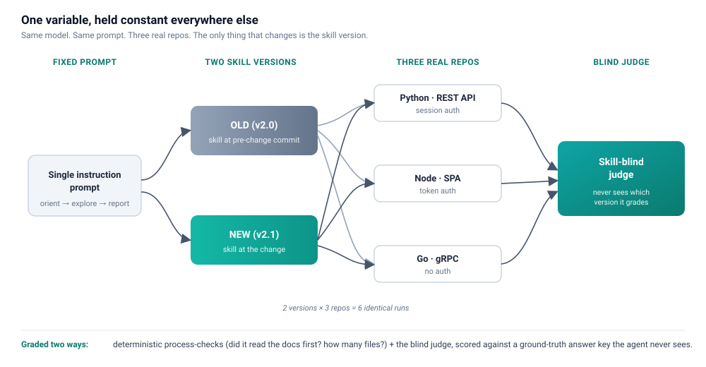

We ship a lot of agent skills. They teach Claude Code, Cursor, Codex, Copilot, and Antigravity how to run HawkScan, understand an app, find vulnerabilities, and fix them. Every week we tweak one: sharpen a prompt, rewrite a workflow, add a reference doc.

And every week we hit the same uncomfortable question: did that change actually help, or does it just feel better?

A reworded skill always reads better to the person who reworded it. The agent’s next run looks smart. Ship it. But “looks smart once” is not evidence, and a security tool that ships on vibes is a security tool you can’t trust. So we stopped trusting our gut and started running an experiment on every meaningful skill change. The shape of that experiment is the whole point of this post:

- Write down a hypothesis: the exact behavior the change should produce.
- Run the same prompts against multiple real repos, under multiple versions of the skill, changing nothing but the skill itself.
- Confirm it with an unbiased judge that never knows which version it’s grading.

If the hypothesis holds across all three repos and an independent grader agrees, we ship. If it doesn’t, we found out before our customers did. Here’s how each step works, using a real change we made last month.

## What an agent-skill eval harness is

An agent-skill eval harness is a repeatable test rig for a single question: did a change to a skill actually change the agent’s behavior the way we intended? You hold everything constant except the skill, run the same task across several real codebases on both the old and new version, and grade the results with a judge that never knows which version it saw. It turns “this feels better” into a scorecard.

## Step 1: State the behavior the change should produce

You can’t measure “better.” You can measure a specific, observable behavior. So before touching anything, we write down what the change is supposed to do.

Our example: app discovery. HawkScan can’t scan an app it doesn’t understand. Before it configures a scan, the agent has to figure out how the app runs, what its API looks like, whether it’s a single-page app, and whether it needs authentication. For a while our skill drove that with a rigid checklist of find and grep commands: look for `openapi.yaml`, grep for `@PreAuthorize`, run a node one-liner against package.json.

It worked, but it was narrow. Real repos describe themselves in `README`s, `CLAUDE.md` files, and `CONTRIBUTING` guides, and our checklist ignored all of it. So we rewrote the skill to be docs-first: read what the repo already tells you, then explore to fill the gaps, then ask the human when you’re still unsure.

That gave us a hypothesis sharp enough to test:

> The docs-first skill will make the agent read the repo’s own documentation before drawing conclusions, and explore more of the codebase, all without getting any of the app details wrong.

Note the two halves. There’s the thing we want to move (docs-first orientation, broader exploration) and the thing that must not regress (correctness). A change that reasons more nicely but starts getting the answers wrong is not a win, and the hypothesis has to be able to catch that.

## Step 2: Same prompts, multiple repos, multiple versions

The core idea is boring on purpose: run the exact same task twice, changing only the skill version.

- **Two versions, side by side.** The OLD arm loads the skill at its pre-change git commit. The NEW arm loads it at the change. Same model, same prompt, same repos. The only variable is the skill. Because everything else is held constant, any difference in behavior is attributable to the change.
- **Three real repos.** We test on the kind of code the skill will actually meet in the wild: real, running software that real people use. That means favoring random open-source projects, not fixtures we built to flatter the change, and specifically not the deliberately-vulnerable “hack me” training apps. Those are built different: they over-explain low-level concepts and narrate their own vulnerabilities right there in the code, so an agent looks brilliant on them for reasons that evaporate the moment it hits a normal codebase. Real apps don’t hand you the answers. We spread the three across different languages, API styles, and auth models (exactly the variety discovery has to handle), and three of them means a result has to repeat to count; one good run on one lucky repo proves nothing.
- **Programmatic runs, not chats.** These aren’t interactive sessions where we steer the agent toward a nice answer. Each cell is a headless Claude Code execution (`claude --print`), handed one fixed instruction prompt that spells out exactly what we expect the session to do: orient, explore, and report its findings in a structured block. Same prompt every time. Think of it like an AI eval or a unit test: a repeatable, non-interactive run you fire off on purpose to measure a big change, not a conversation. Each of the six runs (two versions × three repos) happens in its own fresh clone with its own throwaway config, so nothing leaks between them.

Six identical prompts, one variable. That’s the experiment.

### Two guardrails that keep the eval honest

An eval you can fool is worse than no eval, so two guardrails keep this one honest. The agent can’t see the answer key. We write down the correct answers for each repo ahead of time and grade against them, but the agent never reads them; its working directory is locked to only the cloned app, so the ground truth lives outside its reach entirely. And we scope the run to the hypothesis: our change lived early in the skill’s loop (discovery), so we ran the agent read-only to short-cycle the loop and get answers faster. A hypothesis further down the loop (say, actually fixing the vulnerabilities) would need the full read-write run. Either way, the harness always blocks the answer key and any push to a remote.

## Step 3: Confirm with a skill-blind judge

Now the payoff. We grade every run two ways, and the second is the one that keeps us honest.

Deterministic process-checks read each run’s transcript and answer objective questions with no opinion involved: did the agent read the repo’s own docs before it stated a conclusion? How many distinct files did it explore? Did it fall back to the old checklist? These are the backbone. They’re not debatable.

A skill-blind judge is the confirmation. A separate Claude call, running with no skills and no tools, scores each run’s final answers against the ground truth and rates how thoroughly the agent investigated. Crucially, it never sees which version produced the work it’s grading. It can’t root for the new skill because it doesn’t know the new skill exists. When an independent grader that has no stake in the outcome reaches the same conclusion the process-checks do, the hypothesis is confirmed, not just asserted by the person who made the change.

When the two layers disagree, the objective signal wins. But the whole reason for the blind judge is that agreement between a mechanical count and an independent reviewer is a lot harder to fool yourself with than either one alone.

## What the numbers said

Here’s the scorecard for the discovery change, averaged across the three repos:

| Metric | OLD (v2.0) | NEW (v2.1) |
| --- | --- | --- |
| Read the repo’s own docs | 1 of 3 apps | 3 of 3 |
| Read docs before concluding | 1 of 3 | 3 of 3 |
| Distinct files explored | 8.7 | 13.7 |
| Fell back to the old grep/node checklist | 1 of 3 | 0 of 3 |
| Discovery answers correct (of 5) | 4.67 | 4.33 |

The headline: the new skill oriented from the repo’s own documentation on all three apps; the old one did it on one. It explored more broadly and never fell back to the rote checklist. That’s exactly the behavior the hypothesis predicted, and it showed up in the deterministic signal, not just the judge’s opinion. The blind judge independently agreed the new runs investigated more thoroughly.

### The honest part

The correctness came out a tie (both versions nailed host, API style, SPA, and auth on every app; the only wobble was a “dev command vs. production docker compose” judgment call the judge dinged on both arms). We’re not going to tell you the new skill made the agent more accurate. It didn’t, measurably, at this sample size. It made the agent reason better on its way to the same answers, with no regression. That’s a real, defensible win, and it’s exactly the claim the hypothesis was written to test.

One more bit of honesty: this is three repos, one run each. It’s directional evidence, not a p-value. It’s enough to green-light a change and catch a regression; it’s not a research paper. We flag that limitation every time.

## Wrap-up

Shipping AI skills without measuring them is how you accumulate changes that each felt like an improvement and collectively drift nowhere. The fix isn’t complicated: write down what the change should do, run the same task across a few real repos on the old version and the new one, and let an unbiased grader tell you whether the hypothesis held. That turns “I think this is better” into “here’s the scorecard.” It confirmed our discovery rewrite did what we set out to do, and it kept us honest about what it didn’t do.

The same rigor we ask of our scanner, we now ask of the skills that drive it. That’s the point worth taking with you: the harness that grades our skills is the reason we trust the scanner those skills run. When your AI agent uses Wingman by StackHawk to find and fix vulnerabilities, the skills driving it earned their place on a scorecard, not a vibe. [Sign up for Wingman](https://auth.stackhawk.com/wingman/) and put it in your own coding workflow. Kaakaww!
