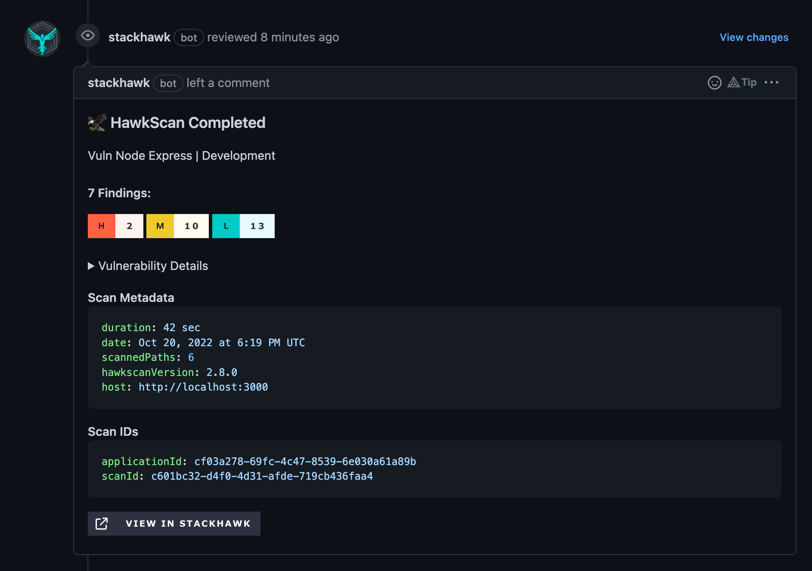

With all the requirements of modern development, few may be as important as ensuring the security of your application is maintained. Keeping the state of your application’s security visible and up-to-date should be one of the highest priorities for your engineering team.

To aid with this, StackHawk provides an [Official GitHub App](https://github.com/apps/stackhawk) capable of doing just that! With a small amount of configuration, you will be able to receive commit statuses and pull request comments that immediately inform you about the state of your application security.

## To the Left

Part of the shift-left mindset is to leverage tools and processes that can provide critical information sooner in the development lifecycle. By correlating the evolution of source code with the results of your dynamic application security testing (DAST), the hope is to find issues sooner and to make them more visible in primary development workflows.

Commit statuses provide you greater peace of mind in knowing that your HawkScan has completed, so that you can be alerted quickly if your application scans detect vulnerabilities or happen to break from new code changes. Detailed results are never too far away either, as there is a link straight to the StackHawk platform with the full scan details on each commit status.

Pull request comments include high-level summaries of found application vulnerabilities in context with the code changes, so an increase in vulnerabilities can be seen immediately in the pull request and can be squashed before ever making it to the main development branch.

By committing to communicate important information as early as possible in your development process, your team is equipped to make decisions and execute on the facts faster than ever before. The ultimate goal is to empower engineers to iterate faster, confident that they are upholding the security requirements of the application.

## Putting it in Action

StackHawk is a dynamic application security testing tool (DAST), meaning HawkScan tests the running application and not the source code. Therefore, linking to the source code requires a little help.

Because we encourage HawkScan usage as part of your CI/CD pipeline, it isn’t a stretch for us to assume that you are incrementally scanning new commits and branches all the time. By leveraging the assumption that scans are running in a CI/CD pipeline, we are able to provide a few configuration options that allow your pipeline to explain how this scan maps back to your source code’s history.

To enable this feature, you will need to have the StackHawk GitHub App installed, with GitHub repositories connected to StackHawk applications for all repositories that you want to enable commit statuses and PR comments for.

Then, you’ll need to adjust this configuration snippet for your `stackhawk.yml` and CI/CD provider, so that your CI/CD pipeline can explicitly tell StackHawk where this scan belongs in your Git history.

```yaml
tags:
  - name: _STACKHAWK_GIT_COMMIT_SHA
    value: ${YOUR_CICD_PROVIDED_ENV_VAR_SHA:}
  - name: _STACKHAWK_GIT_BRANCH
    value: ${YOUR_CICD_PROVIDED_ENV_VAR_BRANCH:}
```

After specifying these tags, your next successful scan on a pull request will include a high-level overview of any DAST findings.



For a complete how-to, check out the [official documentation](https://docs.stackhawk.com/workflow-integrations/github-app/github-pr-checks.html).

## 👀 See it in Action

<video controls preload="none" playsinline width="1280" height="720" poster="/writing/stackhawk-github/github-pr-checks-poster.jpg">
  <source src="/writing/stackhawk-github/github-pr-checks.mp4" type="video/mp4" />
  <a href="/writing/stackhawk-github/github-pr-checks.mp4">Watch the demo: GitHub pull request checks with StackHawk (4 min).</a>
</video>

## That’s a Wrap

With the modern era of software development, security is everyone’s responsibility, but that does not make it any easier. In fact, it’s harder than ever before.

The best thing we can do to keep our applications safe is equip our processes with the tools to provide us the details we need to make the most informed decisions that we can. Choosing tools that enable us to automatically and quickly gather the right information, and use them to their fullest potential is one of our most important responsibilities.
