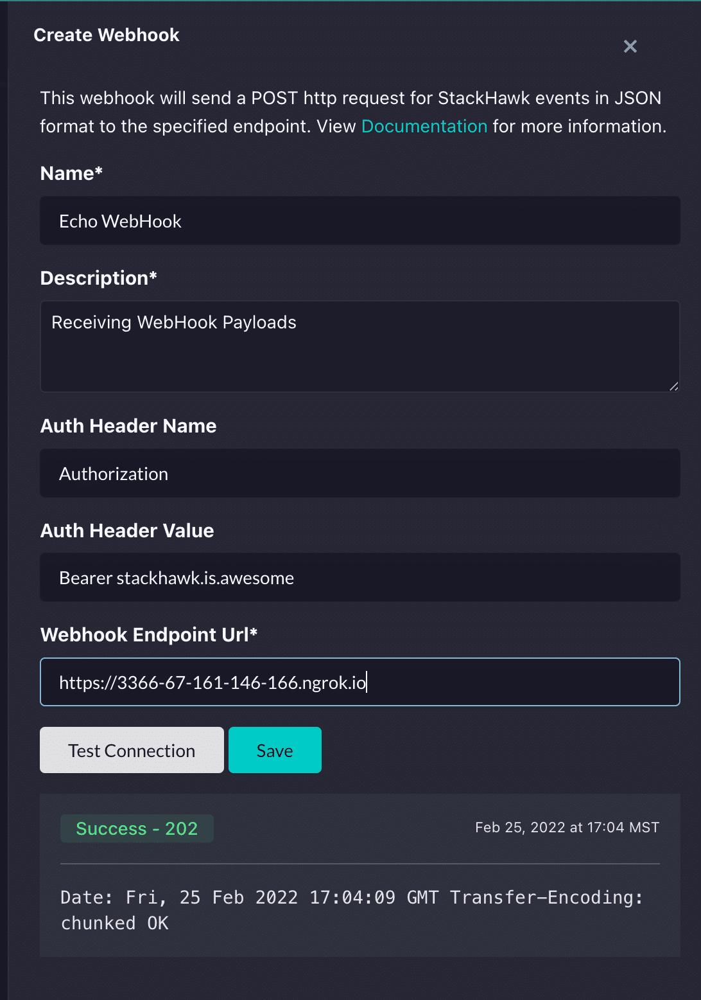
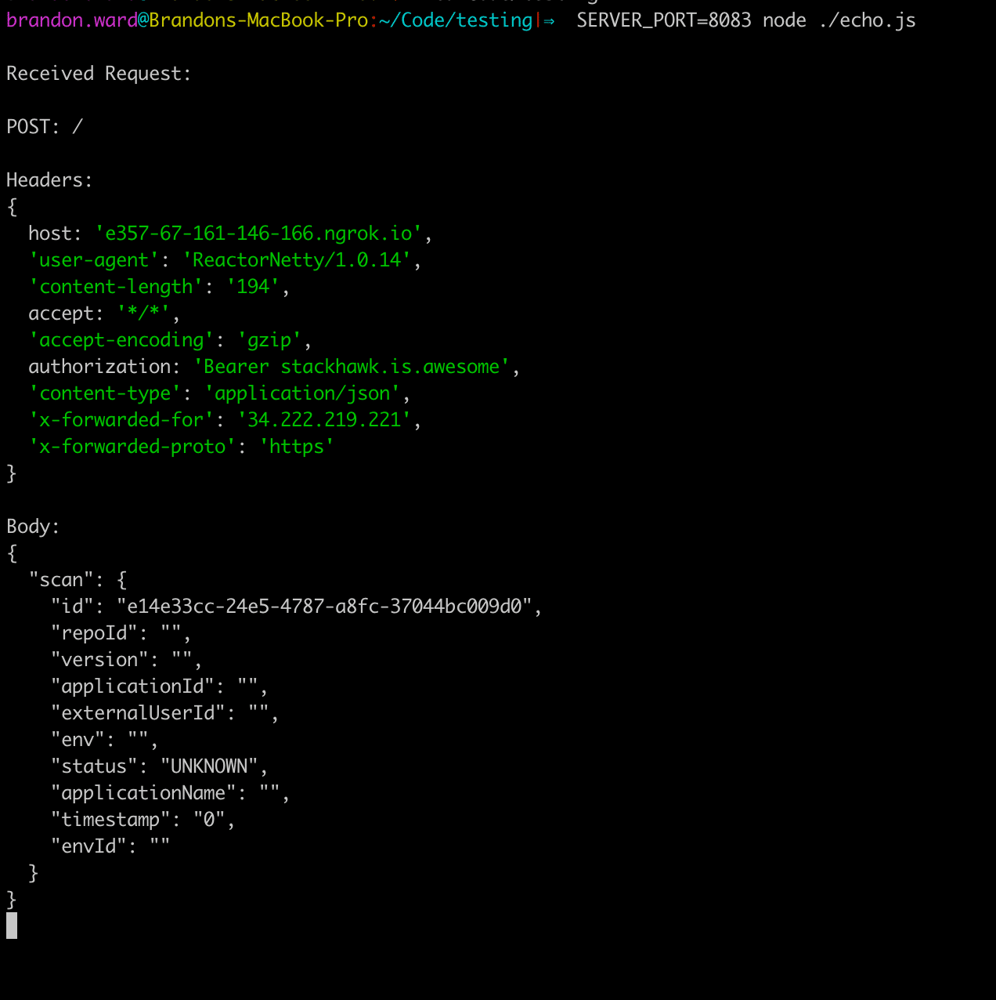

A webhook, or event driven web callback, can best be described as a “Reverse API”, meaning that an external third party will provide the API specification / contract, but it is up to you, the consumer, to implement this API.  You have probably come across webhooks in action, even without knowing it! If your organization automatically triggers source code builds from commits, chances are your source control is alerting your build system via a webhook!  Did you know that [StackHawk also provides a webhook](https://docs.stackhawk.com/workflow-integrations/webhook.html)? It can programmatically keep you informed on all of your completed scans.

## Tools

- The webhook provider - this can be a third party such as GitHub, Jenkins, or StackHawk. For this post, we’ll be using StackHawk’s webhook.

- [ngrok](https://ngrok.com/) - a networking tool to allow making your local API publicly accessible.

- (optional) [node](https://nodejs.org/) - if you aren’t developing your own application (yet), you can use the provided and simple `echo.js` script which will print out all inbound network requests.  Feel free to use your own application framework and API as well!

## (Optional) Run the sample application

If you haven’t started writing your own application yet, you can run this simple node js application (in the linked gist) that simply logs all requests.  This simple node js application is also useful if you want to inspect the requests being sent by your webhook provider!(save as `echo.js`):

[https://gist.github.com/Bwvolleyball/c6315f3a744d2e3f52fece0cfd121dca](https://gist.github.com/Bwvolleyball/c6315f3a744d2e3f52fece0cfd121dca)

```js
const http = require('http');
const server = http.createServer();

// create an echo function that logs the request & body,
// and responds with a 2xx status code and OK.
const echo = (request, response, body) => {

    body = Buffer.concat(body).toString();

    console.log('\nReceived Request:\n')
    console.log(`${request.method}: ${request.url}`);
    console.log('\nHeaders:');
    console.log(request.headers);

    console.log('\nBody:');
    if (request.headers['content-type'] === 'application/json') {
        // pretty print the body if it's JSON.
        console.log(JSON.stringify(JSON.parse(body), null, 2));
    } else {
        // otherwise, just show us what we got.
        console.log(body);
    }

    response.statusCode = request.method.match(/^(POST|PUT|DELETE)$/) ? 202 : 200;
    response.write('OK\n');
    response.end();
};

// start the node server on a specific port, and echo all requests sent to the server.
server.on('request', (request, response) => {
    let body = [];
    request.on('data', (chunk) => body.push(chunk))
        .on('end', () => echo(request, response, body));
}).listen(process.env.SERVER_PORT || 8080);
```

After you’ve saved this file, you can run it locally with this command:

`SERVER_PORT=8080 node echo.js`

## Start ngrok

Next, you’ll want to start ngrok.  After you’ve followed ngrok’s configuration instructions, just run `ngrok http 8080` (or whatever port your application is running on locally).

You’ll notice that this command details a few forwarding entries, we’re most interested in the `https` URL it creates for us, as many webhook providers (StackHawk included) require an SSL secured connection.

## Configure Webhook Details

If you are following along with StackHawk, you’ll provide this URL to the StackHawk webhook configuration (or another webhook provider such as GitHub).



If you are using the supplied `echo.js` script, the values for authorization can be anything you’d like, or nothing at all. If you’re developing your own application, this value should be equivalent to how you expect StackHawk to authenticate with you.

## Activate the Webhook!

Perform an operation that causes a webhook event!

The StackHawk webhook emits an event with each successful scan.  Check out our docs to [run your own scan](https://docs.stackhawk.com/hawkscan/running-hawkscan.html), scan one of our [sample applications](https://github.com/kaakaww), or read more about our [webhook](https://docs.stackhawk.com/workflow-integrations/webhook.html).

If you’re using something else like GitHub, push a commit to your repository!

If you are running the example node js application, you’ll see that it has logged the request from your webhook event.



And that’s it! Now you have all the tools you need to start quickly developing with webhooks!
