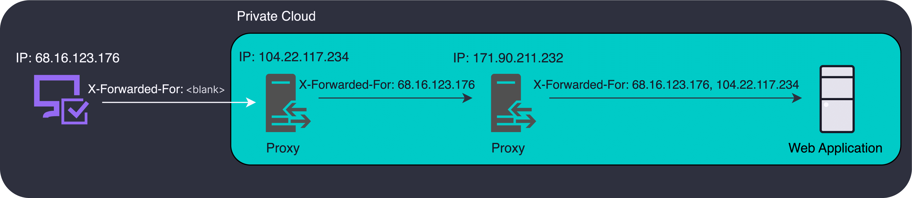

## `X-Forwarded-For` is Easy to Spoof

Here at StackHawk, we received several reports of security researchers being able to bypass our API rate limiting protection. At a high level, our rate limiter is keyed from the client IP address. What we discovered is that our API was accepting spoofed IP addresses via the `X-Forwarded-For` header.

This header is user controllable, so any values a user sends for this header will end up at the front. Users can send anything they like, from spoofed IP addresses to completely invalid values. It is up to us to sanitize and ignore the junk!

As we dug deeper, we realized that a misconfiguration in our API framework was causing it to always select the first value received via `X-Forwarded-For`, without any validation.

Let's explore some of the finer details of this header and look at how some popular cloud providers, application frameworks, and web servers handle it.

## `X-Forwarded-For` Specification

The `X-Forwarded-For` header is intended to be used by proxies in your networking chain to track the IP address of the client from where the call originated. When a web request is made, the server receiving the request is aware of the IP address that is calling it. When using the `X-Forwarded-For` header, the receiving server should append the calling client’s IP address to the list of IP addresses in that header value. The resulting header might look something like this:

`'X-Forwarded-For: <client>, <proxy1>, <proxy2>'`

This diagram illustrates how the `X-Forwarded-For` header is built on its way to an API:

[Mozilla provides the full specification for this header](https://developer.mozilla.org/en-US/docs/Web/HTTP/Headers/X-Forwarded-For) if you'd like to read more.

In a perfectly trusted environment, the first IP address in the list is the source IP address of the original client. The first IP address added by your proxy is the one you want to select. However, the world of software development is not a perfectly trusted environment. You can only trust what you can control.

Proxies servers do not clear this header by default, they only append to it. An attacker can generate requests with values for this header, and if you aren't careful, your application will use these false values.

### Uses of `X-Forwarded-For`

There are a few ways we can leverage the values of `X-Forwarded-For` in our product or monitoring experience. It is important to have accurate values when doing so.

- **Audit logs** - Many industries have complex audit requirements, including being able to identify who did something in the system. Even though an IP address alone is not definitive, it is an important breadcrumb to include in an audit log to ensure the actions occurring in your system are what you expect.

- **Rate Limiting** - Although it is better to rate limit API calls from a user id, this only works when the user is logged in. If unauthenticated API calls are allowed, the only way to identify unique users is by their IP address.

- **Geo-location** - IP addresses correlate to locations, and you can get a rough idea of where your user base is by correlating IP addresses to locations.

If we want to rely on IP addresses for any of these features, we must verify how this IP address is being selected to ensure we have an accurate value. For any of these features, allowing a spoofed or malicious IP address will break the value proposition of the feature.

## `X-Forwarded-For` in Cloud Providers

Cloud providers follow the specifications of the `X-Forwarded-For` header, and many will default to append mode. [Amazon Web Services (AWS)](https://docs.aws.amazon.com/elasticloadbalancing/latest/application/x-forwarded-headers.html) and [Google Cloud Platform (GCP)](https://cloud.google.com/load-balancing/docs/https#x-forwarded-for_header) will add IP addresses to the list by default, with zero validation or verification on existing IP addresses in that list. The important thing to highlight is that any existing `X-Forwarded-For` IP addresses are maintained at the front of the list.

There are also proxies you can run yourself, such as NGINX, [which also lets you configure how `X-Forwarded-For` is handled](https://nginx.org/en/docs/http/ngx_http_proxy_module.html#var_proxy_add_x_forwarded_for). While NGINX is very configurable, their sensible default function behaves like AWS, which appends the remote address of the client to the list of header values.

It is important to highlight the differences between AWS and GCP in how they handle these headers. This illustrates that every situation is unique, and your situation will depend on your cloud provider(s), proxy server(s), and application framework(s) handling the requests.

AWS strictly appends a single IP address of the calling client to the `X-Forwarded-For` header. GCP will append two IP addresses, the IP address of the calling client, followed by the IP address of load balancer the request passed through.

AWS: `'X-Forwarded-For: <whatever-was-on-the-request-before>, <aws-detected-client-ip>'`

GCP: `'X-Forwarded-For: <whatever-was-on-the-request-before>, <gcp-detected-client-ip>, <gcp-load-balancer-ip>'`

Already we can see the divergence between major cloud players, and why parsing this header for an accurate value will be difficult. In both cases, `<whatever-was-on-the-request-before>` can be nothing, a value from an additional network proxy, or it could be malicious or spoofed values. The only commonality is that both append IP addresses to the original header value.

When you are a service provider with a publicly accessible API layer, requests originate from layers outside of your control. Whether this is your UI or direct API access, **you cannot trust the request by default**. Untrusted clients can put whatever IPs they like in the `X-Forwarded-For` header, which pollutes the values with spoofed or malicious data. Values in this header range from the most untrusted on the left to the most trusted on the right. **We can only trust what we can control**.

## `X-Forwarded-For` Parsing Examples

Many popular application frameworks provide automatic parsing of this header, but your solution will ultimately depend on your specific environment. A naive approach to parsing this header is to simply grab the first one in the list. In a perfectly trusted world, that is the original client’s IP address. **Don't actually do this in production, it is insecure**.

### Spring Boot

Spring Boot is a popular Java based application framework with many features. One of these features is automatic handling of the `X-Forwarded-For` header.

[Spring Boot naively grabs the first value in the X-Forwarded-For header list](https://github.com/spring-projects/spring-framework/blob/695601aa0681047c0922096bb880b8ec48c1e32a/spring-web/src/main/java/org/springframework/web/util/UriComponentsBuilder.java#L380), without any validation and no way to customize which value is selected.

Given what we know about the `X-Forwarded-Header`, Spring Boot will always select the spoofed IP address if it exists in the request. The default configuration is susceptible to consuming spoofed client IP addresses.

### Tomcat

Tomcat is a popular Java based web server capable of handling the low-level concerns of running a Java application as a web service.

[Tomcat has a better approach to parse `X-Forwarded-For`](https://github.com/apache/tomcat/blob/c3511b1baf7defc57923fce7e12b5e6b392c68c5/java/org/apache/catalina/filters/RemoteIpFilter.java#L788-L800), where it walks the list of IP addresses in reverse order, looking for the first trusted IP address, while providing a mechanism to skip internal proxy IP addresses.

An example of an internal proxy IP address we want to skip would be the `<gcp-load-balancer-ip>` from above.

Tomcat will select a more accurate IP address, and can be configured to select the first trusted IP address, whether it is at the end of the list or somewhere in the middle.

In the case where we had multiple proxies in front of our application, Tomcat’s ability to generically filter out internal proxy IPs will lend itself to selecting the correct client IP address compared to Spring Boot which is too naive.

### Configure Your Framework

We now know that Spring Boot will select the least trusted client IP address, but Tomcat will only select the correct client IP address if you describe internal proxies to it. Otherwise, it'll just extract the IP address at the end of the list. Depending on the final shape of your networking stack and the behavior of your proxy server, this could be an internal IP address.

If it's been a minute since you've verified your `X-Forwarded-For` configuration, or maybe you just accepted your framework's default implementation for this, now is the perfect time to verify how you use this header.

## Lessons Learned

When underlying frameworks or platforms provide features, it’s common to use their implementation details without a second thought.

The nature of these frameworks is that they may have been written awhile ago. They cannot possibly account for all the ways they will be used.

This is a great example of how the default implementation of our framework left us open to this rate limiter bypass vulnerability.

### How We Fixed It

As mentioned above, the first value in this header is only accurate in a completely trusted environment, and so our framework's default implementation is insecure since it does not account for untrusted values in that header.

This prompted us to restrict our rate limiting logic to prefer user ids instead of IP addresses, so that IP addresses are only used for unauthenticated API calls. We have very few unauthenticated API calls. More importantly, we discovered that our application framework blindly selected the first IP address from `X-Forwarded-For` as the source of truth.

We revamped this logic to be more intelligent about how these IP addresses were chosen, and similar to the Tomcat approach, **we now grab the first valid IP address from the end**.  We intentionally extract values that we know come from trusted sources in our control.

This is another classic example of input validation. When it’s at the low-level networking layer like this it has the potential to go largely unnoticed.

### Are You Safe?

Have you explicitly validated how your own applications handle `X-Forwarded-For`?

More importantly, you must validate it by approaching the problem as an attacker would. Inspect the features that you have which rely on this client IP. Rate limiters, audit logs, or geographical usage stats, and try sending in spoofed `X-Forwarded-For` addresses.

Do your applications use this spoofed value, or do they select the correct one added by your proxy with an accurate value?
